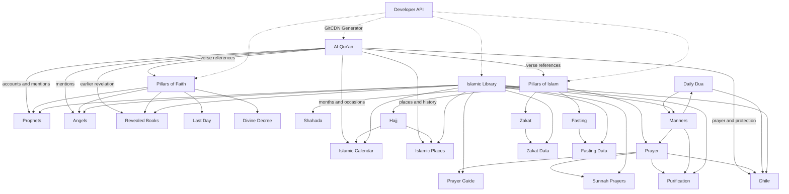

<p align="center">
  
</p>

<h1 align="center">Islamic JSON</h1>

<p align="center">All data json about Islam</p>

## Repository Layout

This `main` branch contains the JSON data, guides, catalog, and schemas. The
Vue website is maintained separately on the `docs` branch. Its GitHub Pages
workflow checks out this branch's UI and checks out `main` into `data/` at build
time; JSON data is therefore not duplicated in `docs`.

## Data Collections

The repository separates reusable content and reference datasets from
step-by-step learning material:

- `library/` — Qur'an, dua, dhikr, Asmaul Husna, pillars of Islam and faith,
  sunnah prayers, zakat and fasting references, prophets, angels, calendar,
  places, and manners.
- `guides/` — prayer, purification, and introductory pillars-of-Islam guides.
  More procedural guides, such as Hajj and Umrah, belong here.

Collection READMEs describe their files and data shapes. The website explorer
on the `docs` branch exposes selected datasets under the **Library** and
**Developer API** navigation items.

## Machine-readable Catalog

[`catalog.json`](./catalog.json) is the repository-wide dataset index. It uses
[Schema.org JSON-LD](https://schema.org/DataCatalog) with `DataCatalog`,
`Dataset`, and `DataDownload` types. Each collection lists its JSON download
endpoints, language metadata, keywords, related datasets/guides via `relatedLink`, and repository location. Consumers can
use this catalog to discover available data without relying on a hard-coded
file list.

[`catalog.schema.json`](./catalog.schema.json) uses JSON Schema Draft 2020-12
to validate the catalog. After adding or moving a collection, update the
metadata in `scripts/generate_catalog.py` and regenerate the catalog:

```bash
python scripts/generate_catalog.py
```

### Path migration

Collections formerly stored at the repository root now live under `library/`;
procedural datasets live under `guides/`. This changes raw and CDN URLs that
used the old paths. Update consumers to the paths listed in `catalog.json` (for
example, `dhikr/data/morning-dhikr.json` is now
`library/dhikr/data/morning-dhikr.json`).

## Data Sources

Qur'an Arabic text, Indonesian translation, and Kemenag tafsir are sourced from
the official [Qur'an Kemenag](https://quran.kemenag.go.id) website. The source
code used to retrieve and convert this data is available in the
[quran-json-kemenag](https://github.com/dyazincahya/quran-json-kemenag)
repository. English translation by Talal Itani is sourced from Tanzil.net via the
[English translation data](https://github.com/dyazincahya/quran-api-with-php-codeigniter/tree/master/public/assets/quran/other/translation/en).
Kemenag tafsir data is also available in the
[quran-api-with-php-codeigniter source](https://github.com/dyazincahya/quran-api-with-php-codeigniter/tree/master/public/assets/quran/kemenag/surah).

## Data Relationships

The following diagram shows how primary sources, pillars, worship guides,
knowledge collections, and developer access relate to each other. An
interactive version is available on the **Data Relations** page in the UI.


